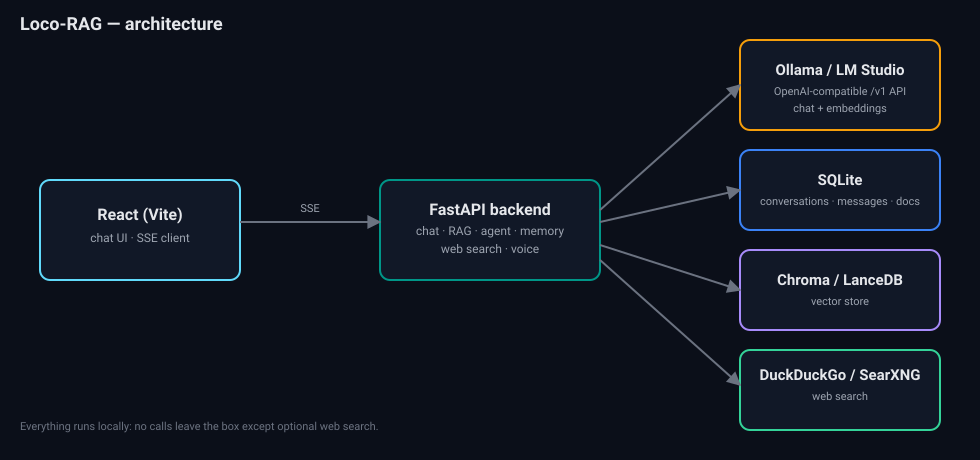
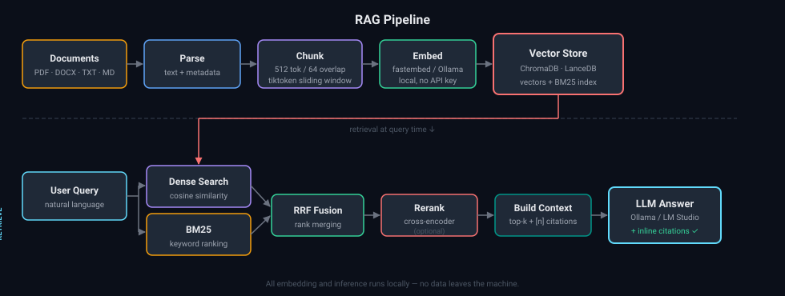

<div align="center">

# 🦙 Loco-RAG · Local LLM Chat with RAG

**A privacy-first, fully-local chat app for self-hosted LLMs — with document Q&A, agents, memory, web search, and voice.**

Talk to **Ollama** & **LM Studio** models, chat with your own documents, and let an agent search them for you — all on your machine. Nothing ever leaves the box.

[](https://github.com/ROHITCRAFTSYT/Loco-RAG/actions/workflows/ci.yml)
[](LICENSE)


</div>

> **Why?** Cloud chat apps send your conversations and documents to someone else's servers.
> Loco-RAG gives you the same ChatGPT-class experience — streaming, RAG, citations, agents,
> voice — running entirely against a local model. No API keys, no telemetry, no data leaving home.

<p align="center">
  
</p>

## ✨ Highlights

| | |
|---|---|
| 💬 **Streaming chat** | SSE, markdown + code, stop / edit-and-rerun, tokens/sec |
| 📚 **Deep RAG** | Hybrid retrieval (dense + BM25 → RRF), optional rerank, **MMR diversification**, **inline citations** |
| 🗂️ **Vector store** | ChromaDB *or* LanceDB — swap with one env var |
| 📎 **Talk to this doc** | Attach a file to a single message for ephemeral RAG |
| 🤖 **Agent mode** | Model decides when to search your docs / the web |
| 🧠 **Memory** | Older turns summarized to stay in the context window |
| 🌐 **Web search** | DuckDuckGo or self-hosted SearXNG, cited |
| 🎙️ **Voice I/O** | Local speech-to-text (faster-whisper) + read-aloud |

## Features

- **Streaming chat** over SSE with stop / edit-and-rerun, markdown + syntax-highlighted code.
- **Multi-conversation** sidebar (create, rename via auto-title, pin, search, delete).
- **Model switcher** that auto-discovers installed Ollama / LM Studio models (vision models flagged).
- **RAG / document Q&A** — drag-and-drop PDF, DOCX, TXT, MD, CSV, code. Token-aware chunking,
  **hybrid retrieval** (dense + BM25 fused with RRF), optional cross-encoder **reranking**,
  optional **MMR diversification** (`ENABLE_MMR`) so the context isn't several near-duplicate
  passages, and **inline citations** with an expandable source panel.
- **Collections / knowledge bases** — group docs and scope a chat to a collection.
- **"Talk to this doc"** — attach a file to a single message (paperclip) for ephemeral RAG over
  just that file, without adding it to a persistent collection.
- **Agentic tool-calling** — toggle **Agent** and the model decides for itself when to call the
  document-search and web-search tools, chaining multiple rounds before answering.
- **Voice in / out** — dictate with local speech-to-text (faster-whisper) and have replies read
  aloud with the browser's built-in speech synthesis.
- **Conversation memory** — older turns are summarized to stay within the context window.
- **Web search** — per-message toggle (DuckDuckGo out of the box, or self-hosted SearXNG).
- **Pluggable vector store** — ChromaDB (default) or LanceDB, switch with one env var.
- **Local embeddings** — `fastembed` (bundled) or an Ollama embedding model. No data leaves the box.
- **Themes**, per-conversation system prompt and sampling params, tokens/sec readout.

## Architecture

<p align="center">
  
</p>

```
React (Vite) ──SSE──> FastAPI ──> Ollama / LM Studio   (chat, OpenAI /v1 API)
                          ├──────> SQLite               (conversations, messages, docs)
                          ├──────> Chroma / LanceDB     (vectors)
                          └──────> DuckDuckGo / SearXNG (web search)
```

Key seams: `services/llm` (provider abstraction), `services/vectorstore` (Chroma/LanceDB factory),
`services/rag.py` (hybrid retrieval + the **one** context-builder shared by RAG, web, and memory).

**What happens on a chat turn** (`routers/chat.py`):

1. Validate the provider, persist the user message, summarize old turns if over budget (`services/memory.py`).
2. Gather context: hybrid retrieval over the selected collection(s) (run in a worker thread so it
   never blocks other streams) and/or web search — or, in agent mode, let the model call those as tools.
3. Stream the answer over SSE: `sources` → `warning`* → `token`… → `usage` → `done` (or `error`).

**Failure behaviour.** Every model and vector-store call is wrapped:

| Failure | What the user gets |
|---|---|
| Ollama / LM Studio down, model not pulled, timeout | SSE `error` naming the provider, URL and fix (e.g. `ollama pull llama3.1`); `502` on JSON endpoints |
| Embedding / vector store / rerank fails during chat | Turn continues without documents; SSE `warning`, and the model is told to say it couldn't consult them |
| Same, on `/api/search/documents` | `503` with the failing `stage` |
| Web search rate-limited / offline | Turn continues; SSE `warning` |
| Agent tool throws | The model sees `Tool error: …` and answers without it |
| Bad collection name on upload | `422` up front (not a silent background failure) |
| Anything unexpected | JSON `500` with a `request_id` matching the logs; no internals leaked |

<p align="center">
  
</p>

## Quick start (Docker)

Prereqs: Docker, and a local LLM runtime. For Ollama:

```bash
ollama pull llama3.1
ollama pull nomic-embed-text   # only if EMBED_PROVIDER=ollama
```

Then:

```bash
cp .env.example .env
docker compose up --build
```

The backend image is multi-stage (no compilers at runtime), installs from the hash-pinned lock,
runs as a non-root user, and **bakes the tokenizer and default embedding model into the image** so
the container starts and answers with no internet access (CI boots it with `--network none` to
check). Build with `--build-arg PRELOAD_EMBED_MODEL=0` if you use `EMBED_PROVIDER=ollama`.

- UI:  http://localhost:5173
- API docs: http://localhost:8000/docs
- Health: http://localhost:8000/health

Seed the default collection with the bundled sample document so RAG works immediately
(ask *"How tall is the Eiffel Tower?"* with Documents enabled):

```bash
docker compose exec backend python -m scripts.seed      # or, in local dev: python -m scripts.seed
```

Enable the private SearXNG search engine instead of DuckDuckGo:

```bash
docker compose --profile websearch up --build   # then set WEBSEARCH_PROVIDER=searxng
```

## Local dev (no Docker)

**Backend**

```bash
cd backend
python -m venv .venv
.venv\Scripts\activate        # Windows
source .venv/bin/activate     # macOS / Linux
pip install -r requirements-dev.txt && pip install --no-deps -e .   # exact pinned versions
# or: pip install -e ".[dev]"                                       # latest within pyproject ranges
uvicorn app.main:app --reload --port 8000
```

**Frontend**

```bash
cd frontend
npm install
npm run dev      # http://localhost:5173 (proxies /api to :8000)
```

## Switching the vector store

Set `VECTOR_BACKEND=chroma` or `VECTOR_BACKEND=lancedb` in `.env`, restart, and re-ingest your
documents. Both implement the same `VectorStore` interface in `backend/app/services/vectorstore/`.

## Tests

```bash
cd backend
pytest --cov          # 151 tests, ~87% line coverage; CI fails under 85%
```

Unit tests cover chunking, RRF, MMR, memory, the agent loop, web search and its SSRF guard, config
validation, LLM error translation (via `httpx.MockTransport`), logging, and the eval metrics.
Integration tests drive the real FastAPI app (upload → ingest → search → delete, chat degradation
paths) and run a shared contract suite against **both** real embedded vector stores, Chroma and
LanceDB. Only the embedder and the LLM are faked, so the suite needs no model downloads.

## Retrieval & answer evaluation

`backend/eval/` holds a small golden set: an 11-document corpus about this app (including
near-neighbour documents, such as MMR next to hybrid retrieval and page-fetch safety next to web
search, so retrieval has something to get wrong) and 24 questions, each labelled with its relevant
document(s) and a short reference answer. Three questions need two documents.

```bash
cd backend
python -m scripts.eval_retrieval                       # retrieval + context recall (no LLM)
python -m scripts.eval_retrieval --answers --model llama3.1   # + answer faithfulness (needs Ollama/LM Studio)
python -m scripts.eval_retrieval --min-recall 0.9 --min-context-recall 0.8 --json report.json
```

| Metric | Measures | Needs LLM |
|---|---|---|
| recall@k, hit-rate, MRR, nDCG | does retrieval rank the right *documents* in the top k | no |
| context recall | share of each reference answer's sentences supported by the top `RERANK_TOP_N` chunks (what the model actually sees) | no |
| answer faithfulness | share of the generated answer's sentences supported by that same context | yes |

Faithfulness and context recall are **lexical** proxies (`app/eval/faithfulness.py`): a sentence counts
as supported when ≥60% of its content words appear in one retrieved passage. They under-credit
paraphrase and can't detect negation, so use them to catch regressions on this fixed set, not as
absolute truth. For a stronger signal, swap in an LLM judge. `--min-*` flags exit non-zero, so the
script can gate CI.

### Benchmark

<!-- BENCHMARK -->

## Production notes

- **Config validation.** `app/config.py` checks every setting at startup: enum values
  (`VECTOR_BACKEND`, `EMBED_PROVIDER`, `DEFAULT_PROVIDER`, `WEBSEARCH_PROVIDER`, `LOG_*`), numeric ranges,
  http(s) base URLs, `CHUNK_OVERLAP_TOKENS < CHUNK_SIZE_TOKENS` and `RERANK_TOP_N ≤ RETRIEVE_TOP_K`. A typo
  stops the process with a message naming the setting. Previously `VECTOR_BACKEND=lance` silently ran Chroma.
- **Structured logging.** `LOG_FORMAT=json` (the Docker default) writes one JSON object per line
  with `ts`, `level`, `logger`, `msg`, `request_id` and structured fields (`path`, `status`, `ms`, `model`,
  `stage`, …). Every line logged while handling a request carries that request's id, which is also
  returned as `X-Request-ID` (a sane incoming `X-Request-ID` from a proxy is reused).
- **One worker with Chroma.** Chroma's embedded `PersistentClient` is thread-safe but
  [not process-safe](https://cookbook.chromadb.dev/core/system_constraints/), so keep `UVICORN_WORKERS=1`
  with the default store. To scale out, run a Chroma server.
- **Pinned dependencies.** `backend/requirements.txt` / `requirements-dev.txt` are hash-pinned,
  cross-platform locks generated by `uv` (Python 3.11). `pyproject.toml` keeps the version ranges. CI runs
  `pip check` to make sure the lock still satisfies them. To regenerate, run the command in each file's header.
- **CI** (`.github/workflows/ci.yml`, all actions pinned to commit SHAs): lint, tests with a coverage
  floor, the retrieval eval against the real embedder and Chroma (results in the job summary), the frontend
  build, and a Docker build plus an offline boot smoke test of the backend image.

## Configuration

All settings live in `.env` (see `.env.example`) and map to `backend/app/config.py`.

## Roadmap / ideas (deferred)

OCR for scanned PDFs · multi-modal (image) RAG · a UI dashboard over the
retrieval-eval metrics · streaming tool-call traces in the UI · single-user PIN auth.
